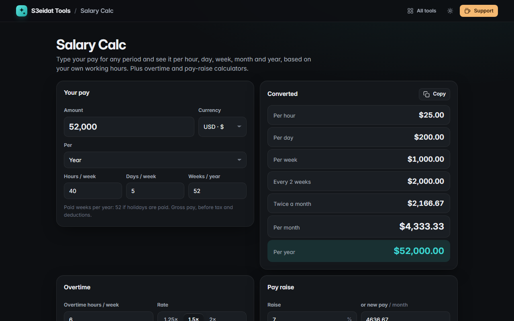

# Salary Calc

> Convert pay between hourly, daily, weekly, monthly and yearly, with overtime and raise calculators. Free, private, and it runs entirely in your browser.

### ▶ [Open Salary Calc](https://s3eidat.github.io/salary-calc/)



## Features

- Enter pay **per hour, day, week, 2 weeks, half month, month or year** and see all the others at once
- Uses **your** hours per week, days per week and paid weeks per year
- Click any converted period to make it the input
- **Overtime**: hours per week at 1.25×, 1.5× or 2×, per week and per month
- **Pay raise**: type a raise % or the new monthly pay (two-way) to see the new hourly, monthly and yearly pay and the increase
- **Currency selector** with proper formatting (JOD, KWD, BHD and OMR show 3 decimals); copy all periods as text

All figures are gross pay, before tax, social security and other deductions.

## Privacy

Your numbers never leave your device. There is no server, no account, no analytics.
The page ships with a strict Content-Security-Policy (`connect-src 'self'`), so the browser
itself blocks any attempt to send data anywhere.

## Run it yourself

It's plain HTML, CSS and JavaScript with no build step:

```bash
git clone https://github.com/s3eidat/salary-calc
cd salary-calc
python -m http.server 8000
```

Then open http://localhost:8000.

## Support

If this saved you time, **[buy me a coffee ☕](https://s3eidat.github.io/coffee/)**. It keeps every tool free.

---

Part of **[S3eidat Tools](https://s3eidat.github.io/)**: 100+ free, private tools that run in your browser. MIT licensed.
